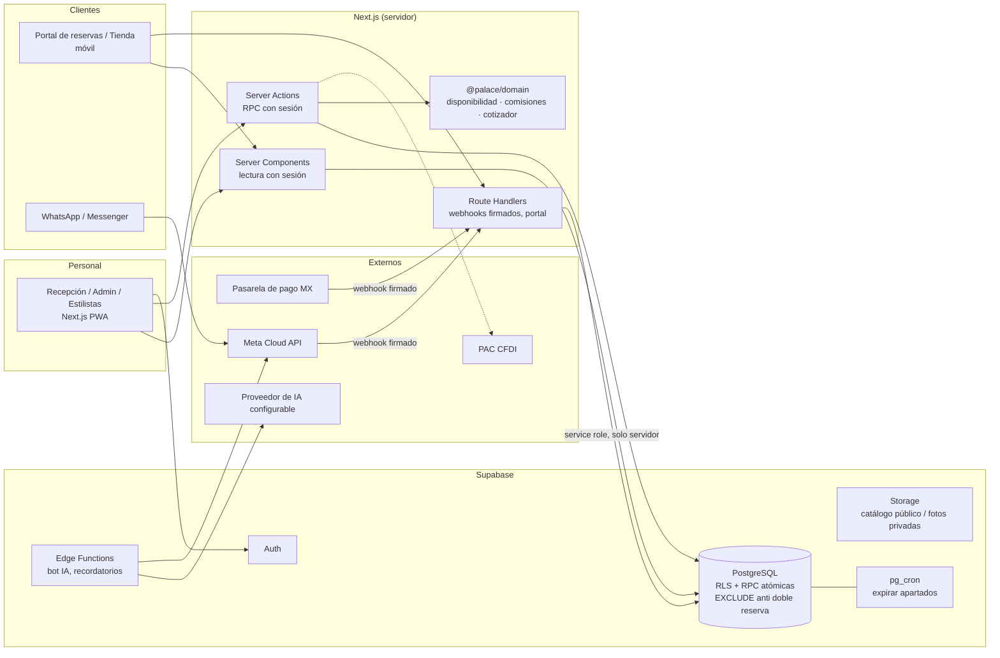

# 04 · Arquitectura

## 1. Decisiones de stack (verificadas 2026-10-21)
| Capa | Elección | Versión | Motivo |
|---|---|---|---|
| Frontend | Next.js (App Router, Server Components, Server Actions) | 16.4.2 | Pedido por la clienta; SSR seguro con sesión en cookies; un solo despliegue para panel, portal y tienda. Nota: en Next 16 `middleware` se renombró a `proxy.ts` (verificado en la documentación incluida en el paquete). |
| UI | React + Tailwind CSS | 19.3.1 / 4.3.3 | Tokens CSS para marca provisional; sin librería de componentes pesada. |
| Validación | Zod | 4.3.3 | Validación de formularios en servidor. |
| Backend | Supabase: PostgreSQL, Auth, RLS, Storage, Realtime, Edge Functions | supabase-js 2.118, @supabase/ssr 0.12.7, CLI 2.121 | Ya conocido por el equipo; RLS y funciones en BD dan las garantías críticas. |
| Lógica pura | Paquete `@palace/domain` (TypeScript sin dependencias) | — | Motor de disponibilidad, comisiones, cotizador, mantenimiento, transferencia bot→humano. Probado con Vitest 4. |
| Pruebas | Vitest + PostgreSQL real | Vitest 4.1, PG 16 local / 17 en CI | Las garantías de concurrencia solo se prueban contra una BD real. |
| Hosting | Vercel Pro (propuesto) + Supabase Pro | — | Vercel Hobby no permite uso comercial (ver docs/10). |

## 2. Diagrama



## 3. Principios
1. **Las garantías viven en la base de datos.** Doble reserva: restricciones `EXCLUDE` (btree_gist) sobre rangos `tstzrange`. Sobreventa: bloqueo de fila (`SELECT … FOR UPDATE`) + `CHECK (reserved <= on_hand)`. Pagos duplicados: llaves únicas por proveedor/referencia e idempotencia por llave. El frontend puede fallar; la BD no deja pasar estados inválidos.
2. **El motor de disponibilidad propone; la BD dispone.** `findAvailableSlots` calcula horarios en TypeScript (rápido, testeable); al reservar, la BD revalida horario, turno, capacitación y recursos, y la exclusión resuelve carreras.
3. **RLS deny-by-default.** Todas las tablas con RLS; lectura por rol; escrituras críticas solo vía RPC `SECURITY DEFINER` con `search_path = ''` y verificación de rol (`app.require_role`).
4. **Una sola fuente de existencias** (`stock_levels`) para POS, citas y tienda.
5. **Estados ortogonales**: reserva, asistencia, pago y materiales son columnas separadas.
6. **Secretos solo en servidor**: la llave `service_role`/secreta nunca llega al navegador; webhooks verifican firma antes de tocar la BD.
7. **Adaptadores para servicios externos**: pagos, mensajería, IA y CFDI se integran detrás de interfaces; sin credenciales se usa un adaptador de desarrollo claramente marcado, nunca una simulación presentada como real.

## 4. Estructura del repositorio
```
apps/web/                 Next.js (panel del personal; portal y tienda en V2)
  app/(staff)/            dashboard, agenda, agenda/nueva, inventario, clientes
  lib/                    supabase (server), availability, roles, errores, formato
  proxy.ts                refresco de sesión y protección de rutas
packages/domain/          lógica pura + pruebas unitarias
supabase/
  migrations/             esquema versionado (timestamp)
  tests/                  pruebas de integración contra PostgreSQL (concurrencia, RLS, flujos)
  seed.sql                datos ficticios de desarrollo
  config.toml             Supabase CLI (registro público deshabilitado)
scripts/db-test.sh        BD desechable + migraciones + pruebas
.github/workflows/ci.yml  tipos, pruebas de dominio, pruebas de BD, build
docs/                     esta documentación
```

## 5. Entornos
| Entorno | Base de datos | Uso |
|---|---|---|
| Pruebas | PostgreSQL desechable (`palace_test`) con un *shim* mínimo de Supabase (`supabase/tests/shim`) | CI y local sin Docker |
| Desarrollo | `supabase start` (Docker) + `seed.sql` | Desarrollo de UI |
| Staging (propuesto) | Proyecto Supabase propio de Palace o *branch* | Validación con la clienta |
| Producción | Proyecto Supabase **nuevo y exclusivo** de Palace | — |

No se reutiliza ningún proyecto, llave ni dato de Shakeaholic u Hojaldras Lily. Aún **no se ha creado** ningún proyecto Supabase ni despliegue (requiere autorización y decisión de cuenta/plan de la clienta).

## 6. Multi-sucursal
Las tablas operativas llevan `location_id` y las zonas horarias se toman de `locations.timezone`. No se implementa aislamiento multiempresa; agregar sucursales no requiere rediseñar el esquema, solo políticas por sucursal cuando aplique (V4).

## 7. Integraciones (estado)
| Integración | Estado | Decisión |
|---|---|---|
| Pagos (Mercado Pago recomendado) | Tablas/idempotencia listas; adaptador pendiente | docs/10, docs/11 |
| WhatsApp Cloud API / Messenger | Esquema de conversaciones, webhooks idempotentes y guardas bot/humano listos | docs/08 |
| Manychat | Alternativa puente vía webhooks | docs/08 |
| CFDI (Facturapi recomendado) | Pendiente; sin facturación ficticia | docs/10 |
| Correo transaccional (Resend) | Pendiente | docs/10 |
| IA | Interfaz por funciones controladas; proveedor configurable | docs/08 |
| Google Calendar | No en MVP: la agenda propia es la fuente de verdad; sincronización de solo lectura opcional en V3 | docs/11 |
