# 05 · Modelo de datos

Fuente de verdad: `supabase/migrations/*.sql`. Este documento resume entidades, relaciones e invariantes.

## 1. Diagrama entidad-relación (núcleo)

```mermaid
erDiagram
  locations ||--o{ business_hours : tiene
  locations ||--o{ special_days : tiene
  locations ||--o{ resources : tiene
  locations ||--o{ stock_levels : guarda
  staff_members ||--o{ staff_schedules : turnos
  staff_members ||--o{ staff_time_off : ausencias
  staff_members ||--o{ staff_services : "capacitada en"
  services ||--o{ staff_services : ""
  services ||--o{ service_resource_requirements : requiere
  resource_types ||--o{ service_resource_requirements : ""
  resource_types ||--o{ resources : unidades
  services ||--o{ service_materials : "receta (BOM)"
  product_variants ||--o{ service_materials : ""
  products ||--o{ product_variants : variantes
  product_variants ||--o{ stock_levels : existencias
  product_variants ||--o{ stock_movements : ledger
  product_variants ||--o{ stock_reservations : reservas
  clients ||--o{ appointments : agenda
  clients ||--o{ client_consents : consentimientos
  clients ||--o{ client_notes : notas
  clients ||--o{ client_photos : fotos
  appointments ||--o{ appointment_services : servicios
  appointments ||--o{ appointment_allocations : ocupa
  appointment_services ||--o{ appointment_allocations : ""
  staff_members ||--o{ appointment_allocations : ""
  resources ||--o{ appointment_allocations : ""
  appointments ||--o{ stock_reservations : materiales
  appointments ||--o{ appointment_deposits : anticipos
  appointments ||--o{ maintenance_reminders : seguimiento
  sales ||--o{ sale_lines : lineas
  sales ||--o{ sale_payments : pagos
  sales ||--o{ refunds : devoluciones
  cash_sessions ||--o{ sales : corte
  appointment_deposits |o--o| sales : "aplicado en"
  conversations ||--o{ messages : mensajes
```

## 2. Dominios y tablas
| Dominio | Tablas | Notas |
|---|---|---|
| Organización | `locations`, `business_settings` (singleton), `business_hours`, `special_days` | Zona horaria por sucursal. `business_settings.brand` guarda la identidad provisional. |
| Personal | `staff_members` (vinculado a `auth.users`), `staff_schedules`, `staff_time_off`, `staff_services` | Turnos partidos = descansos. Duración/precio por persona en `staff_services`. |
| Servicios y recursos | `services`, `service_categories`, `resource_types`, `resources`, `service_resource_requirements`, `service_materials`, `service_cost_items` | **Cada unidad física es un recurso** (4 sillas = 4 filas) para que la exclusión garantice capacidad. |
| Catálogo | `products`, `product_variants`, `product_images`, `brands`, `product_categories`, `suppliers` | Variante = SKU con tono, largo, textura, presentación, unidad, gramos. |
| Inventario | `stock_levels`, `stock_movements`, `stock_reservations`, `purchase_orders(+lines)`, `stock_counts(+lines)` | `available = on_hand − reserved` (vista `v_stock_availability`). |
| Agenda | `appointments`, `appointment_services`, `appointment_allocations`, `appointment_deposits`, `waitlist_entries`, `maintenance_reminders`, `ops_alerts` | Ocupación vigente en `v_busy_allocations`. |
| CRM | `clients`, `client_consents` (histórico, inmutable), `client_notes` (general/sensible), `client_photos` | Vista `v_client_current_consents`. |
| POS | `cash_sessions`, `sales`, `sale_lines`, `sale_payments`, `refunds`, `gift_cards`, `coupons` | Vista `v_commissionable_lines` (base auditable de comisiones). |
| Mensajería | `conversations`, `messages`, `internal_notes`, `webhook_events` | Estado de conversación = máquina bot/humano. |
| Auditoría | `audit_log` | Disparadores en tablas sensibles + eventos RPC. |

## 3. Invariantes garantizados por la base de datos
| Invariante | Mecanismo | Prueba |
|---|---|---|
| Una persona no puede estar en dos lugares a la vez | `EXCLUDE USING gist (staff_id WITH =, occupied WITH &&) WHERE (active …)` | `booking.test.ts` escenario 1, 4, 5 |
| Un recurso (estación) no se usa dos veces a la vez, incluida limpieza | `EXCLUDE … (resource_id WITH =, occupied WITH &&)`; `occupied` incluye preparación y limpieza | "limpieza de 20 min…" |
| Nunca existencias negativas ni reservado > existencias | `CHECK (on_hand >= 0 AND reserved >= 0)`, `CHECK (reserved <= on_hand)` + bloqueo de fila | escenario 2, 6 |
| El historial de inventario no se altera | Disparador `IMMUTABLE_LEDGER` + `revoke update, delete` | "movimientos inmutables" |
| Un pago del proveedor se registra una vez | `unique (provider, provider_ref)` en anticipos y pagos | escenarios 12, 15 |
| Una venta no se duplica por reintento | `sales.idempotency_key unique` | "idempotencia del cobro" |
| Un webhook se procesa una vez | `unique (provider, event_id)` | escenario 12 |
| El bot no responde con humano a cargo | Disparador `BOT_SILENCED` | escenarios 10–11 |
| Una sola respuesta por mensaje entrante | índice único parcial `messages(in_reply_to)` | "solo una respuesta…" |
| Fotos solo con consentimiento vigente | Disparador `CONSENT_REQUIRED` | "fotografías…" |
| Un apartado tiene fecha de expiración | `CHECK (booking_status <> 'hold' OR hold_expires_at IS NOT NULL)` | escenario 15 |
| Solo una caja abierta por sucursal | índice único parcial | "corte de caja" |

## 4. Estados de la cita (dimensiones independientes)
| Dimensión | Valores |
|---|---|
| `booking_status` | `hold` → `confirmed` → `cancelled` / `expired` |
| `attendance_status` | `scheduled` → `arrived` → `in_service` → `completed` · `no_show` |
| `payment_status` | `not_required` · `pending` · `deposit_paid` · `paid` · `refunded` · `needs_refund` |
| `materials_status` | `not_required` · `reserved` · `missing` · `consumed` · `released` |

## 5. Dinero y tiempo
- Importes en **centavos enteros** (`integer`); porcentajes en puntos base (1000 = 10%).
- Precios con **IVA incluido**; `sales.tax_cents` es informativo (no es un CFDI).
- Instantes en `timestamptz`; horarios del negocio en hora local (`time`) + `locations.timezone` (America/Mexico_City, sin horario de verano desde 2022).

## 6. Pendientes de modelo (siguientes iteraciones)
- Lotes de cabello y costo promedio ponderado (V4).
- Desglose de efectivo por denominación en el corte (portar de Shakeaholic).
- Pedidos de tienda en línea (`online_orders`) que reutilizan `stock_reservations` con `source = 'online_order'` y expiración (V2).
- Gastos fijos/variables y categorías contables (V2).
