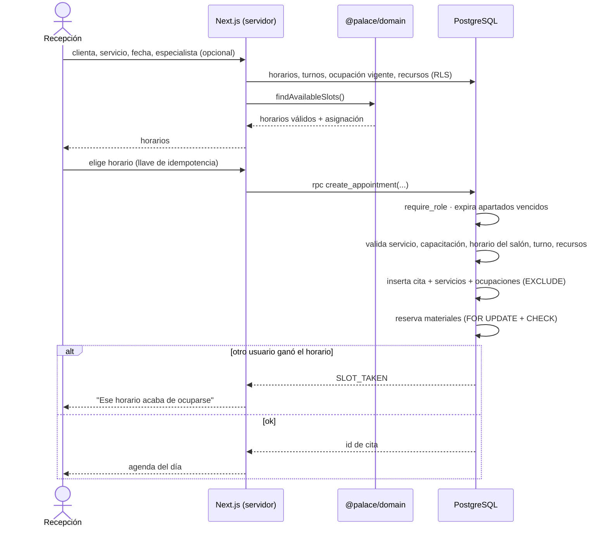
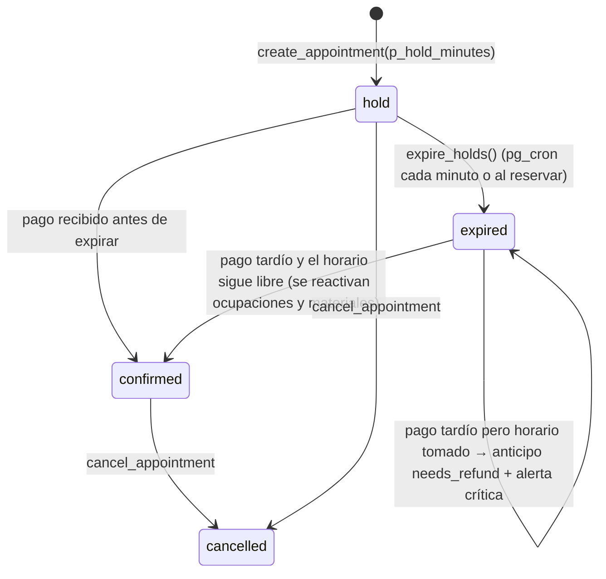

# 07 · Flujos de reservas y control de capacidad

## 1. Cómo se evita la doble reserva
Cada ocupación es una fila en `appointment_allocations` con un rango `occupied` (`tstzrange`) y **exactamente uno** de: `staff_id` o `resource_id`. Dos restricciones de exclusión impiden traslapes entre filas activas:

```sql
constraint no_staff_overlap    exclude using gist (staff_id    with =, occupied with &&) where (active and staff_id is not null),
constraint no_resource_overlap exclude using gist (resource_id with =, occupied with &&) where (active and resource_id is not null)
```

- **Capacidad**: cada unidad física es un recurso (3 estaciones = 3 filas en `resources`). El motor asigna una unidad libre; la BD garantiza que esa unidad no se repita.
- **Carreras**: si dos transacciones insertan ocupaciones que se traslapan, PostgreSQL hace esperar a la segunda; cuando la primera confirma, la segunda recibe `exclusion_violation` → la RPC devuelve `SLOT_TAKEN`. Probado con dos conexiones concurrentes reales (`supabase/tests/booking.test.ts`, escenario 1).
- **Preparación y limpieza** forman parte del rango ocupado: personal `[inicio − preparación, fin + (limpieza si la hace ella) + margen)`, recurso `[inicio − preparación, fin + limpieza)`. Ejemplo verificado: instalación que termina a las 15:00 con 20 min de limpieza → la estación queda libre a las 15:20.
- **Ausencias y bloqueos** también son ocupaciones (`kind = 'time_off' | 'block'`), así que la misma restricción impide agendar sobre vacaciones.

## 2. Motor de disponibilidad
`@palace/domain` → `findAvailableSlots()` recibe horario del negocio, turnos (ya sin descansos/ausencias), ocupación existente y recursos, y devuelve horarios con asignación propuesta (especialista + unidades de recurso). Soporta duración por especialista, varios servicios consecutivos, preferencia de especialista, anticipación mínima y paso configurable. La app lo alimenta desde la BD (`apps/web/lib/availability.ts`) y la BD revalida todo al reservar.

## 3. Flujo: nueva cita en recepción (MVP, implementado)



## 4. Flujo: apartado con anticipo y pago tardío (escenario 15)



- Los materiales reservados por un apartado expiran con él (`stock_reservations.status = 'expired'`).
- El mismo pago del proveedor (`provider`, `provider_ref`) nunca se registra dos veces.
- La reubicación o reembolso de un pago tardío es una decisión humana (alerta en dashboard).

## 5. Cancelación (escenario 3)
`cancel_appointment` desactiva ocupaciones, libera materiales reservados y devuelve si fue cancelación tardía según `services.cancellation_min_hours` o la política general. El anticipo **no** se reembolsa automáticamente: se aplica la política (❓ pendiente de definir con la clienta: ¿se pierde, se abona, se reembolsa?).

## 6. Cambio de especialista (escenario 4)
`reassign_appointment_service` valida capacitación, turno y disponibilidad (exclusión). Conserva el horario; si la nueva especialista tiene otra duración, se debe reprogramar (🟦 mejora V2: recalcular duración automáticamente).

## 7. Vacaciones (escenario 5)
1. La estilista solicita (`request_time_off`).
2. Propietaria/administración decide (`decide_time_off`). Si hay citas en el periodo, devuelve `conflicts` con la lista; **no se aprueba** hasta reasignar o reprogramar.
3. Al aprobar, se crea una ocupación `time_off` que bloquea la agenda.

## 8. Material insuficiente (escenario 6)
- Material reservado para una cita deja de estar disponible para POS y tienda.
- Si al agendar no hay existencias: error `INSUFFICIENT_STOCK`, o con `p_allow_missing_materials` la cita se crea con `materials_status = 'missing'` y una alerta para comprar/conseguir el tono.

## 9. Completar el servicio
`set_attendance` (llegó / en servicio / no asistió) y `complete_appointment`:
- Consume el material **real** (puede ser mayor o menor al reservado; lo no usado se libera).
- Registra consumos adicionales.
- Programa el **recordatorio de mantenimiento** y la próxima visita sugerida según `services.maintenance_interval_days`.

## 10. Portal público (V2)
Flujo: servicio → duración y precio estimado → especialista → fecha → horarios → datos → políticas → anticipo → confirmación. Para instalaciones con `requires_consultation`, el portal ofrece **reservar una valoración** o enviar fotos autorizadas; nunca confirma precio final de servicios personalizados. Implementación prevista: Route Handler del servidor con llave secreta (nunca en el navegador), límite de peticiones y verificación anti-bots, que llama a `create_appointment` con `p_hold_minutes` y genera el cobro del anticipo.
