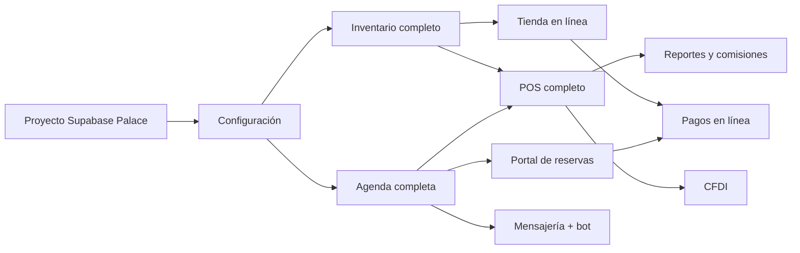

# 09 · Roadmap y estrategia de desarrollo

Cada etapa debe quedar funcional, verificable (pruebas en CI) y documentada antes de pasar a la siguiente. Backlog detallado en [`backlog.md`](backlog.md).

## Estado actual (2026-10-22)

### Entrega 1 — investigación y diseño ✅
Auditoría, benchmark, documentación 01–12, esquema base, motor de disponibilidad y CI.

### Entrega 2 — MVP de operación esencial ✅ (en el stack local)
| Módulo | Rutas | Estado |
|---|---|---|
| Autenticación y roles | `/login`, candado de rol de propietaria | ✅ |
| Configuración | `/configuracion` (negocio, horarios, festivos, servicios con personal/recursos/materiales/costos, recursos, cotizador, comisiones) | ✅ |
| Personal | `/personal` (alta con Auth, turnos, servicios), `/personal/ausencias` | ✅ |
| Agenda | `/agenda` día/semana/recursos, `/agenda/nueva` (varios servicios, tono, apartado), `/agenda/cita/[id]` (asistencia, completar con consumo real, cancelar, reprogramar, cambiar especialista, anticipo), bloqueos, lista de espera | ✅ |
| Recepción asistida | `/recepcion` (llegadas, retrasos, en servicio, estaciones libres, apartados por vencer, alertas) | ✅ |
| Clientas (CRM) | `/clientes` con segmentos, `/clientes/nueva`, expediente con consentimientos, notas sensibles, historial, mantenimiento, inventario apartado, anonimización | ✅ (fotos: falta Storage) |
| Cotizador | `/cotizador` | ✅ (valores de ejemplo por validar) |
| Inventario | productos/variantes, proveedores, movimientos, kardex, conteos, compras con reorden sugerido, exportación CSV | ✅ (imágenes: falta Storage) |
| Punto de venta | `/pos` (carrito combinado, pagos divididos, propinas, cupones, tarjetas de regalo, anticipos, saldo), `/pos/caja` (apertura y corte con desglose) | ✅ |
| Ventas | `/ventas`, `/ventas/[id]` (abonos, devoluciones, cancelación, impresión), CSV | ✅ |
| Reportes | `/reportes` (ventas, más vendidos, comisiones, productividad, cancelación/no-show, clientas nuevas/recurrentes), CSV | ✅ |
| Finanzas | `/finanzas` (gastos, resumen, rentabilidad por servicio), CSV | ✅ |
| Dashboard ejecutivo | `/dashboard` con ocupación, ingresos, KPIs | ✅ |
| Portal público de reservas (V2) | `/reservar` con valoración previa y apartado honesto sin pago | ✅ (pago en línea pendiente) |

**Verificación:** 26 pruebas de dominio, 83 de base de datos (concurrencia real, RLS, flujos) y 73 E2E con Playwright contra Auth y PostgREST oficiales (stack local sin Docker), repetibles en corridas consecutivas. El CI ejecuta todo en cada push.

**Pendiente para producción:** proyecto Supabase de Palace (decisión de la clienta, ver docs/11), Storage (fotos e imágenes), correo transaccional (invitaciones al personal; hoy contraseña temporal mostrada una vez), pasarela de pago, verificación de teléfono en el portal, captcha y límite de peticiones compartido.

## V2 — Experiencia de la clienta
~~Portal público de reservas~~ (hecho, falta pago), tienda en línea con reservas de inventario con expiración, pagos en línea (Mercado Pago) con webhooks firmados, anticipos en línea, recordatorios por correo/WhatsApp (plantillas *utility*), CRM avanzado (segmentos, inactivas), cotizador en UI, panel de recepción asistida, finanzas básicas (gastos, utilidad bruta, rentabilidad por servicio), exportación Excel.

## V3 — Automatización
Manychat como puente (o bandeja propia), recepcionista virtual con funciones controladas, transferencia humana, campañas con consentimiento, seguimiento postservicio y reseñas, CFDI vía PAC (Facturapi propuesto).

## V4 — Optimización
Analítica avanzada, predicción de demanda, reabastecimiento sugerido, lotes y costo promedio, fidelización, varias sucursales.

## Dependencias críticas

