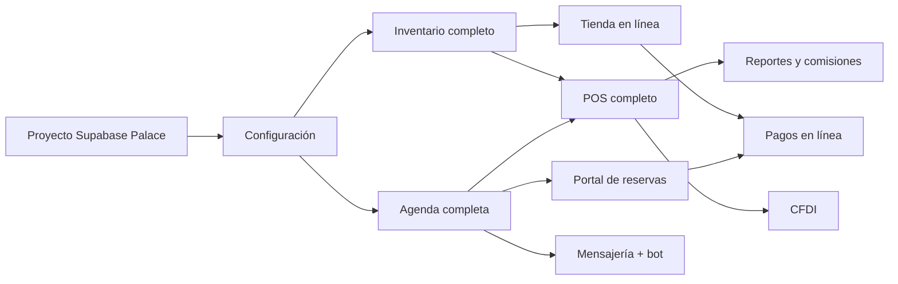

# 09 · Roadmap y estrategia de desarrollo

Cada etapa debe quedar funcional, verificable (pruebas en CI) y documentada antes de pasar a la siguiente. Backlog detallado en [`backlog.md`](backlog.md).

## Estado actual (entrega 1 — 2026-10-21)
| Entregable | Estado |
|---|---|
| Auditoría de proyectos previos y benchmark de mercado | ✅ |
| Documentación 01–12 + backlog | ✅ |
| Monorepo (pnpm), Next.js 16, Tailwind 4, Supabase CLI config | ✅ |
| Esquema completo del MVP en 9 migraciones (RLS, RPC, garantías) | ✅ aplica en PostgreSQL 16 limpio |
| `@palace/domain`: disponibilidad, comisiones, cotizador, mantenimiento, transferencia | ✅ 26 pruebas |
| Pruebas de BD: 15 escenarios obligatorios + extras | ✅ 30 pruebas (incluye concurrencia real) |
| Panel: login, inicio, agenda del día, nueva cita, inventario, clientas | ✅ compila; **no probado contra un Supabase real** (no hay proyecto aún) |
| CI (GitHub Actions) | ✅ definido; se ejecutará en el primer push |

## MVP — Operación esencial (siguiente: 4–6 semanas estimadas ❓)
1. Crear proyecto Supabase exclusivo de Palace (requiere autorización) y aplicar migraciones.
2. Pantallas de configuración: negocio, servicios, especialistas, horarios, recursos, recetas de servicio.
3. Agenda: vista semanal y por recurso, detalle de cita (llegó / en servicio / completar con consumo real), cancelar, reprogramar, bloquear, lista de espera.
4. Expediente de clienta: alta/edición, consentimientos, notas, historial.
5. Inventario: alta de productos/variantes, entradas, mermas, ajustes, conteo físico, órdenes de compra.
6. POS: carrito combinado, pagos divididos, propinas, anticipos, tarjetas de regalo, cupones, devoluciones, corte de caja con desglose.
7. Dashboard básico + reporte de comisiones exportable (CSV).
8. Pruebas E2E (Playwright) de los flujos principales.

## V2 — Experiencia de la clienta
Portal público de reservas (valoración previa para extensiones), tienda en línea con reservas de inventario con expiración, pagos en línea (Mercado Pago) con webhooks firmados, anticipos en línea, recordatorios por correo/WhatsApp (plantillas *utility*), CRM avanzado (segmentos, inactivas), cotizador en UI, panel de recepción asistida, finanzas básicas (gastos, utilidad bruta, rentabilidad por servicio), exportación Excel.

## V3 — Automatización
Manychat como puente (o bandeja propia), recepcionista virtual con funciones controladas, transferencia humana, campañas con consentimiento, seguimiento postservicio y reseñas, CFDI vía PAC (Facturapi propuesto).

## V4 — Optimización
Analítica avanzada, predicción de demanda, reabastecimiento sugerido, lotes y costo promedio, fidelización, varias sucursales.

## Dependencias críticas

